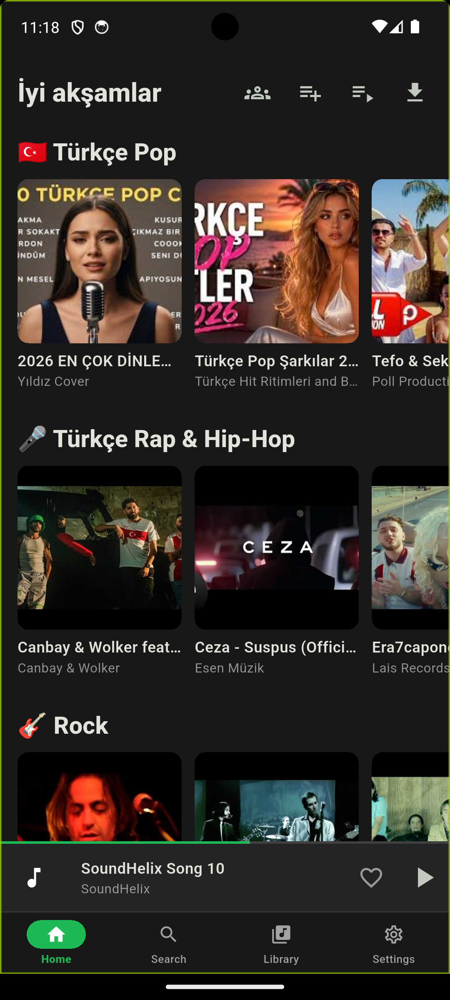
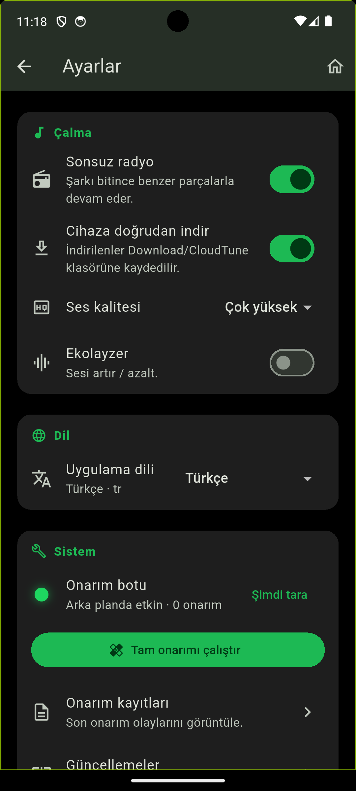

  
  <h1 align="center">🎵 CloudTune</h1>
  
<b>Açık kaynak, YouTube destekli, reklamsız müzik çalar</b>

  

    
    
    
  

**CloudTune**, şarkıları doğrudan cihazdan YouTube üzerinden arayıp çalan,
reklamsız ve açık kaynak bir müzik uygulamasıdır. Güncel sürüm Android mobil için `3.0.64+265`, Linux için `3.0.61+262`; Android TV / Google TV paketi ayrı yayında. Linux oynatma
motoru `media_kit + libmpv`'dir; `deb` paketi `libmpv2`'yi otomatik kurar. Windows
11 paketi eski; iOS kaynak/CI hazır, mevcut IPA eski sürümde.
Otomatik güncelleme Android/Linux içindir. Hesap, abonelik veya PC sunucusu gerekmez.

**3.0.64+265 (mobil Android OTA):** Dinleme geçmişi temizlenince ana sayfa feed/cache yeniden kurulur; arama sekmesinde/sonuç varken temizlense bile ana sayfa öneri bölümleri ve sanatçı başlıkları sıfırlanır. 3.0.62 simge varyantları ve geçmiş temizleme korunur. TV/Windows/IPA/web/Linux varlıkları bu OTA’da değiştirilmedi.

Güncel sürüm ve indirme bağlantıları: **`update.json`** — uygulama içi
güncelleme de bu dosyayı okur.

---

## 📸 Ekran görüntüleri

Gerçek cihazdan alınmış güncel görünümler. Büyütmek için görsele tıklayın.

  
  
  
  

Tam boyut bağlantılar

1. [Cihaz görünümü 1](docs/screenshots/device-01.png)
2. [Cihaz görünümü 2](docs/screenshots/device-02.png)
3. [Cihaz görünümü 3](docs/screenshots/device-03.png)
4. [Cihaz görünümü 4](docs/screenshots/device-04.png)

---

## ✨ Özellikler

### 🎧 Çalma
- **Doğrudan YouTube** — aracı sunucu yok, arama ve akış cihazda çözülür
- **Sonsuz radyo** — kuyruk bitmeden benzer parçalarla genişletilir; kaynak düşse de alternatifler denenir
- **Tekrar modu** — kapalı / tüm listeyi tekrarla / tek parçayı tekrarla; oynatıcıdaki döngü ikonundan değişir
- **Karışık çal** — kuyruğu karıştırır, ikon anında durumu gösterir
- **Ses kalitesi** — düşük / orta / yüksek / kayıpsız; değişimde parça aynı pozisyondan yeniden açılır
- **Arka plan çalma** — ekran kilitliyken devam eder, bildirim/kilit ekranı kontrolleri
- **Ekolayzer** — açılışta ve ayar değişiminde uygulanır, parça değişiminde kesilme yapmaz
- **Ses düzeltmeleri** — ilk oynatmada sessizlik/çizirti oluşmaz
- **Çalma listeleri** — oluşturma, adlandırma, silme ve liste içi sıralama düzenleme; sıra kalıcıdır
- **Sanatçı profilleri** — sanatçının parçaları ayrı çalma listesi olarak kaydedilir ve indirilir

### 🔎 Arama
- **Metin arama** — şarkı, sanatçı ve YouTube bağlantıları; sonuçlar önbellekte tutulur
- **Yerel Whisper sesli arama** — Google/sistem tanıma kullanılmaz; kayıt cihazda
  metne çevrilir. İlk kullanımda ~32 MB model indirilir. Mikrofon **yalnızca**
  düğmeye basıldığında açılır ve izin o anda istenir
- **Arama sonuçları** — müsify benzeri ekran: açık mavi **Ara** başlığı, koyu gri
  yuvarlatılmış arama çubuğu, **Artists** ve **Parçalar** kartları. Kapakta süre
  rozeti, başta `...`, satır sonunda dikey 3 nokta menü (çal / radyo / beğen /
  indir / sanatçı / playlist). Kayıtlı çalma listeleri ve sanatçı radyoları da
  aynı ekrandan erişilebilir.
- **Kendiliğinden değişmez** — ana sayfa ve sonuçlar yalnızca yukarıdan aşağıya
  kaydırınca yenilenir; sanatçı parçaları da ancak o zaman tazelenir

### 🎨 Kişiselleştirme
- **18 vurgu rengi**, **Koyu / Açık / Sistem** teması, OLED siyah zemin
- Açık temada tüm yüzeyler ve metinler tema duyarlı paletten gelir; siyah yazı
  koyu zemin üstünde kalmaz
- **Dil** — Ayarlar'dan seçilen dil uygulamaya anında uygulanır (TR/EN tam,
  diğer diller İngilizceye düşer); sesli aramanın dili de bu ayarı izler
- Dinleme geçmişine göre kişisel ana sayfa

### ⬇️ İndirme ve oda
- Şarkılar doğrudan cihaz depolamasına kaydedilir (`Download/CloudTune`);
  itag/MIME'ye göre doğru uzantı (`.webm` / `.m4a` / `.mp3`), sanatçı ve arama
  grupları ayrı kartlarda; internet olmadan çalınabilir. Masaüstünde Belgeler
  klasörü kullanılır.
- **Odalar** — oda listesi (ad, kod, kişi sayısı, kilit), şifresiz odaya tek
  dokunuşla katılım, davet linkinde şifre (`cloudtune://room/KOD?p=...`),
  uzaktan katılımcı avatarları. Başka cihaz bilgileri kullanıcı onayına bağlıdır.
- **Kararlı avatar** — sürümlü dosya adı ve cache key'i; her çizimde değişmez.

### 🛠️ Onarım botu
Arka planda düşük kaynakla çalışır; akış, indirme ve bağlantı hatalarını sessizce
onarır. Ayarlar → **Tam onarımı çalıştır** tüm aşamaları zorla koşar ve sonucu
gösterir. Loglar yalnızca cihazda tutulur; e-posta/uzak servise veri gönderilmez.

### 🔗 Bağlantılar
Desteklenen adresler: `youtu.be`, `m.youtube.com`, `music.youtube.com`,
`youtube.com`, `www.youtube.com`. Ayarlar → **Desteklenen bağlantılar**
anahtarıyla uygulama içi açma kapatılabilir.

---

## ⬇️ İndirme

| Platform | Dosya | Not |
|---|---|---|
| Android — tüm cihazlar | `CloudTune-universal.apk` | Mimari bilmiyorsanız bunu seçin (Android 7.0+) |
| Android TV / Google TV / Fire TV | [CloudTune-androidtv.apk](https://github.com/Arise1881/cloudtune-dist/releases/download/cloudtune-latest/CloudTune-androidtv.apk) | TV ana ekranında görünür; uzaktan kumanda odağı ve büyük arayüz otomatik |
| Android arm64 | `CloudTune-arm64.apk` | Çoğu modern telefon |
| Android armv7 | `CloudTune-armv7.apk` | Eski 32-bit cihazlar |
| Android x86_64 | `CloudTune-x86_64.apk` | x86 tablet / emülatör |
| Linux (deb) | `CloudTune-linux.deb` | `sudo apt install ./CloudTune-linux.deb` — Başlat Menüsü ikonu/kısayolu gelir, `cloudtune` komutu çalışır |
| Linux (tar.gz) | `CloudTune-linux.tar.gz` | `libmpv2` kurulu olmalı: `sudo apt install libmpv2` |
| Windows 11 | `CloudTune-setup.exe` / `CloudTune-windows.zip` | ⚠️ Eski paket; güncel Windows installer bu Linux ortamında üretilemedi (CI/billing gerekir). 3.0.60+ uygulama kodunda Güncelle, GitHub sürüm sayfasını açar. |
| iOS | `apps.json` kaynağı | ⚠️ Mevcut IPA eski; aynı CI engeli nedeniyle güncellenemedi |

Tüm dosyalar: [son sürüm](https://github.com/Arise1881/cloudtune-dist/releases/tag/cloudtune-latest)

### 3.0.55+256 — uzun süreli kullanım güvenilirliği

- OTA artık platforma uygun dosyayı indiriyor; yarım kalan dosya siliniyor,
  hazırlanmış dosya sürüm ve dosya adıyla doğrulanıyor.
- Hızlı parça geçişlerinde kaynak açılışları sıraya alındı; bayat hata yeni
  parçanın üzerine yazmıyor. Ağ kesilince parça aynı sırada kalıyor.
- Onarıcı üstel geri çekilme kullanıyor; radyo listesi ve oda keşfi kendiliğinden
  yeniden deneniyor, sızan MQTT istemcileri temizleniyor.
- Invidious görece kapak adresleri YouTube CDN'ine bağlanarak mutlak hale
  getirildi; ana sayfa kapakları yükleniyor.
- Doğrulama: `flutter analyze` 0 issue, `flutter test` 103/103; emülatörde
  çalma, bildirim, çevrimdışı regresyon ve kapak önbelleği kontrol edildi.

### 3.0.54+255 — hata sonrası parça atlama düzeltmesi

- Ağ hatası veya boş tampon sonrası ExoPlayer'ın ürettiği bayat `completed`
  sinyali otomatik parça geçişi tetiklemiyor. Geçiş yalnızca parçanın bilinen
  süresinin sonuna gelindiyse yapılıyor.
- Hazırlanmış oynatıcı havuzunda hata veren/sonlanan motor aktif motora
  yükseltilmeden önce atılıyor.
- Emülatörde ağ kesilerek doğrulandı: aktif parça aynı sırada kaldı, başka
  müziğe atlanmadı. `flutter analyze` 0 issue, `flutter test` 96/96.

### 3.0.53+254 — akış çözümleme ve kapak yenileme

- YouTube ses adresi resmî InnerTube `VISIONOS` istemcisi ve oturum kimliğiyle
  çözülüyor; ölü yansıma sunucuları beklenmiyor. Parça açılışı ölçümde 196–483 ms.
- Akış hatasında otomatik başka parçaya geçiş kaldırıldı; parça aynı sırada
  kalıyor ve Türkçe hata gösteriliyor. Radyo modu da aynı kuralı izliyor.
- Ana sayfa kapakları iki CDN yolunu deniyor, görüntülenen boyuta göre decode
  ediliyor ve pull-to-refresh sonrası yeni cache nesliyle taze indiriliyor.
- Türk radyoları, `youtu.be` / `m.youtube.com` / `music.youtube.com` /
  `youtube.com` / `www.youtube.com` bağlantıları ve kullanıcı verileri korundu.
- Doğrulama: `flutter analyze` 0 issue, `flutter test` 91/91; emülatörde
  `PLAYING`, ilerleyen pozisyon, radyo çalma, kapak yenileme ve YouTube
  aktivitesi olmadığı kontrol edildi.

### 3.0.46+247 — arama sonuçları sabit kalır

- Aratılan şarkı kendiliğinden başka parçalara dönüşmüyor; sonuç listesi sabit.
- Sanatçının ilgili yeni parçaları yalnızca yukarıdan aşağıya kaydırıp
  yenileyince listeye ekleniyor. Arama ayarları değişmedi.
- Doğrulama: `flutter analyze` 0 issue, `flutter test` 73/73, emülatör 18/18.

### 3.0.45+246 — hızlı parça açılışı

- InnerTube istemcileri ve Invidious örnekleri eşzamanlı deneniyor; ilk çalışan
  yanıt parçayı açıyor. Takılan bir aday diğerlerini 6'şar sn bekletmiyor.
- Radyo önerisi geçişi bloklamıyor; parça arası boşluk 300 ms'ye indi. Sonraki
  parça adresi daha erken önbelleğe alınıyor, `play()` hazır sinyalini uzun
  beklemiyor.
- Doğrulama: `flutter analyze` 0 issue, `flutter test` 71/71, emülatör 18/18.

### 3.0.44+245 — temiz kurulum varsayılanları ve ekran galerisi

- **Açılış:** uygulama doğrudan **ana sayfa** ile başlar; aramaya üstteki
  büyüteçten veya alt nav’dan geçilir. **Sonsuz radyo** ilk kurulumda açık gelir;
  sonraki açılışlarda kullanıcı tercihi korunur, beğeni/geçmiş/playlist silinmez.
- **Arama:** ortalanmış açık mavi **Ara**, koyu gri yuvarlatılmış çubuk, X ile
  temizleme; **Artists** (yuvarlak avatar + `Sanatçı` + `>`) ve **Parçalar**
  (kare kapak + süre rozeti + `...` + dikey menü) kartları.
- **Erişim:** her parça çalınabilir; menüden radyo, beğeni, indirme, sanatçı ve
  çalma listesine ekleme yapılabilir. Alt nav Home / **Search** / Library /
  Settings; aktif Search ovali, başlık ve ikonlar kullanıcının vurgu rengini
  izler. Library eski kitaplık ekranını açar: profil/avatar ayarları, beğeniler
  ve dinleme geçmişi. Çalma listeleri arama kartlarından ve ana sayfa üstünden;
  Odalar ana sayfa üstünde ve aktif oda banner'ından erişilebilir.
- **Android:** R8 + kaynak küçültme açık; ABI APK'ları 20–26 MB. HTTP trafiği
  kapalı, tüm bağlantılar HTTPS/wss. CI, özel manifest/izinleri koruyan
  commit'li `android/` dosyalarını kullanıyor.
- **Linux:** Stripped binary, `ldd` ile doğrulanan `libmpv2` bağımlılığı,
  sürüm+build numaralı deb (`3.0.44-245`), doğru `StartupWMClass`,
  `/usr/bin/cloudtune` kısayolu ve tarball içinde masaüstü dosyası.
- **Windows:** MSVC LTCG + zorunlu `flutter_windows.dll`. `3.0.52+253` Setup.exe yayında;
  güncelleme bildirimi ZIP indirmez, GitHub sürüm sayfasını açar.
- **iOS:** İmzasız IPA obfuscation ile küçültüldü; mevcut paket CI ödeme limiti
  nedeniyle eski sürümde kaldı.
- **Uygulama:** Oda presence/ack senkronu, doğru kişi sayısı, avatar/discovery
  temizliği; yerel Whisper, indirme/kaydetme, sıralanabilir playlist ve TR/EN dil.

### İlk kurulum
1. Dosyayı indirin; Android'de **Bilinmeyen kaynaklardan yükleme** iznini verin.
2. APK'yı kurun ve uygulamayı açın. Uygulama doğrudan **ana sayfa** ile açılır;
   **sonsuz radyo** varsayılan olarak açıktır.
3. Bildirim iznini verin (arka plan çalma için); mikrofon izni yalnızca sesli
   arama düğmesine bastığınızda istenir.
4. Ayarlar → **Tema**'dan açık/koyu/sistem modunu ve vurgu rengini seçin.
5. Arama kutusuna şarkı yazın veya YouTube bağlantısı yapıştırın. İçerik
   kendiliğinden değişmez; yenilemek için yukarıdan aşağıya kaydırın.

### Cihaz uyumu

| Android | API | Destek |
|---|---|---|
| 7.0 – 7.1 | 24 – 25 | ✅ (`minSdk 24`) |
| 8 – 10 | 26 – 29 | ✅ |
| 11 – 14 | 30 – 34 | ✅ |
| 15+ | 35+ | ✅ (`targetSdk 36`) |

`arm64-v8a`, `armeabi-v7a`, `x86_64` ayrı paketler; bilinmeyen mimaride
`CloudTune-universal.apk` kullanılır. Uygulama güncelleyicisi cihazın ABI'sini
algılar ve uygun paketi indirir. Telefon, tablet, katlanabilir ve geniş ekran
cihazlar desteklenir (`supports-screens`, `resizeableActivity`).

---

## 🔄 Güncelleme

Uygulama açılışta `update.json` dosyasını okur; yeni sürüm varsa ana sayfada
bildirim çıkar. İndirilen APK cihazın ABI'sine göre seçilir (arm64 / armv7 /
x86_64 / evrensel). Kurulum için “Bilinmeyen kaynaklardan yükleme” izni gerekir.

Manifest iki adresten erişilebilir:

- Raw (her zaman güncel): `https://raw.githubusercontent.com/Arise1881/cloudtune-dist/main/update.json`
- GitHub Pages (CDN önbellekli): `https://arise1881.github.io/cloudtune-dist/update.json`

## 📁 Bu depodaki dosyalar

| Dosya | Açıklama |
|---|---|
| `README.md` | Bu sayfa — indirme, kurulum, uyum, güncelleme, gizlilik |
| `index.html` | GitHub Pages indirme portalı (sürüm kartları, QR kodlar) |
| `update.json` | Uygulama içi güncelleyicinin okuduğu OTA manifest |
| `apps.json` | AltStore / SideStore için iOS kaynak manifesti |
| `icon.png` | Uygulama ikonu (Pages ve Linux masaüstü girişi) |
| `header.png` | Pages başlık görseli |
| `apk-qr.png` | Android indirme QR kodu |
| `ipa-qr.png` | iOS kaynak QR kodu |
| `sidestore-qr.png` | SideStore kurulum QR kodu |
| `video-poster.png` | Pages video kapak görseli |
| `tunnel.txt` | Cloudflare tünel / altyapı notu |

Kurulabilir dosyalar depoda değil,
[son sürüm](https://github.com/Arise1881/cloudtune-dist/releases/tag/cloudtune-latest)
asset'lerinde tutulur: `CloudTune-arm64.apk`, `CloudTune-armv7.apk`,
`CloudTune-x86_64.apk`, `CloudTune-universal.apk`, `CloudTune-linux.deb`,
`CloudTune-linux.tar.gz`, `CloudTune-setup.exe`, `CloudTune.ipa`.

---

## 🔐 Gizlilik

Dinleme geçmişi, beğeniler, çalma listeleri, avatar, indirilenler, Whisper
transkriptleri ve dil tercihi yalnızca cihazda saklanır. Ses kaydı cihazda metne
çevrilir, sunucuya gönderilmez; mikrofon yalnızca siz dokunduğunuzda açılır.
Oda durumu genel bir MQTT relay üzerinden taşınır; oda kodunu/şifresini bilmeyen
kişiler aynı kanalı dinleyebilir, bu yüzden hassas bilgi paylaşmayın. Onarım
logları cihazda kalır; e-posta veya uzak servise veri gönderilmez. PC kapalıyken
de uygulama çalışır; yerel servis bağımlılığı yoktur.

## 📄 Lisans

MIT — [kaynak depo](https://github.com/Arise1881/cloudtune)
